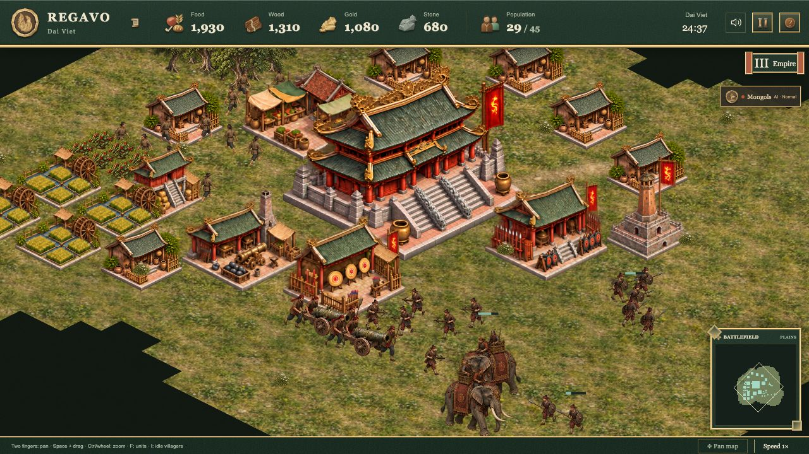

# Regavo — 2D browser RTS

**English** | [Tiếng Việt](docs/vi/README.md) | [简体中文](docs/zh-CN/README.md)

Regavo is a single-player real-time strategy prototype played against AI in a desktop browser. Choose Rome, the Mongols, Persia, Tang China, the Ottomans or Đại Việt, and advance through three ages: Settlement, Military and Empire.

Destroy the enemy town center to win. If both town centers fall in the same simulation tick, the match is a draw. The prototype includes a complete match loop; competitive balance and release performance still need further playtesting.



_An Empire Age (III) Đại Việt settlement with farming, logging and gold mining, and its full unit roster fighting the Mongols. In-game demonstration inspired by the Trần dynasty’s victories over Yuan–Mongol invasions._

## Run locally

Requirements: **Node.js 22.13 or later** and **pnpm 12.8.1**, as declared in `package.json`. Install pnpm using the [official installation guide](https://pnpm.io/installation), then run from the repository root:

```sh
pnpm install --frozen-lockfile
pnpm audit:licenses
pnpm dev
```

Open the URL printed by Vite. The dev server keeps this terminal running. License generation records the packages installed on your platform; it excludes stale packages outside the dependency graph. `pnpm-lock.yaml` is the only dependency lockfile.

In a second terminal, run the complete checks:

```sh
pnpm exec playwright install chromium
pnpm validate
```

For a static production build and local preview:

```sh
pnpm exec playwright install chromium
pnpm build
pnpm exec vite preview --host 127.0.0.1
```

Deploy `dist/` at the web root. The game needs no API key or application backend; simulation and AI run in a Web Worker.

Production builds include only runtime images and required fallback atlases, encoded as pixel-identical lossless WebP with unchanged dimensions and alpha. Historical PNGs and provenance stay in the repository. `dist/asset-manifest.json` records source/output hashes; `pnpm check:assets` verifies every decoded RGBA pixel after a build. The first build encodes images; subsequent builds reuse the content-addressed cache in `node_modules/.cache/regavo-assets/`. Cloudflare cache rules in `public/_headers` apply to hashed artwork and bundles.

Production lobby scenes are rendered from the match models during the build, with an authored sprite required for every unit. All 18 scenes have 960/1920 px lossless WebP variants. The lobby downloads only the selected scene and warms a selection on hover/focus; full sprite sheets load when entering a match or workshop. The first build needs Playwright Chromium (`pnpm exec playwright install chromium`). Verified scene caches live in `node_modules/.cache/regavo-previews/` and regenerate when source art, renderer code or toolchain changes.

[Deployment and releases](docs/en/DEPLOYMENT.md)

## What you can play

- Four resources: food, wood, gold and stone. Villagers gather, hunt and deliver cargo to valid drop-off buildings; cargo is lost when its carrier dies.
- Construction, repair, farms, recruitment queues, rally points and age advancement. Each side has a population limit of 200; Persian and Đại Việt elephants are capped at six, including queued units.
- Six civilization rosters and mechanics, including Roman shields, Mongol mobile camps, Persian trade, Tang production modes, Ottoman cannon deployment and Đại Việt militia mobilization.
- A 96×96 map, three terrain presets, three AI difficulty levels, current-visibility fog, minimap, pause, match speed and browser/JSON saves. Older 64×64 saves remain readable.
- A Model Workshop for inspecting units, buildings, nature, actions and viewing directions. Music and effects are synthesized with Web Audio.
- Vietnamese, English and Simplified Chinese UI. An explicit language selection is saved; otherwise Cloudflare's visitor country takes priority (VN → Vietnamese, CN → Simplified Chinese, US/GB/AU/NZ/IE → English), followed by the first supported browser preference and English as fallback. The Worker supplies country metadata in the HTML before the UI starts; local Vite development uses browser preferences.

## Controls

| Action                                     | Input                                                          |
| ------------------------------------------ | -------------------------------------------------------------- |
| Select                                     | Left-click or drag a selection box                             |
| Add/remove selection; queue orders         | Shift + click; Shift + right-click                             |
| Move or interact with a target             | Right-click; ordinary movement interrupts combat until arrival |
| Attack-move                                | A, then left-click a destination                               |
| Retreat                                    | D, then left-click a destination                               |
| Stop / toggle hold position                | S / H                                                          |
| Select idle villagers                      | I                                                              |
| Assign / recall a control group            | Ctrl/Cmd + 1–9 / 1–9; press a number twice to focus the group  |
| Focus selection or town center             | F                                                              |
| Pan / zoom on a touchpad                   | Two-finger scroll / Ctrl/Cmd + scroll or pinch                 |
| Drag the map                               | Space/Alt + drag, or enable the map-drag button                |
| Rotate a wall or gate / continue placement | R / Shift + click                                              |

Leaving an unfinished match or pressing Back opens a dialog and pauses the match. You can stay, save and exit, or exit without saving; confirmed exits return to the home screen. Autosave runs every 30 seconds and when the tab moves to the background. Refresh/tab-close warnings use the browser's `beforeunload` behavior and may depend on prior user interaction. Export JSON for a portable save.

## Documentation

The [documentation index](docs/en/INDEX.md) separates current rules, design targets and historical evidence. Every maintained page has matching English, Vietnamese and Simplified Chinese versions.

| Topic                                            | Document                                              |
| ------------------------------------------------ | ----------------------------------------------------- |
| Civilizations, rosters and historical references | [Civilizations](docs/en/CIVILIZATIONS.md)             |
| Army composition, controls and counters          | [Force deployment](docs/en/FORCE-DEPLOYMENT.md)       |
| Gathering rates, cargo and mobilization costs    | [Economy](docs/en/ECONOMY.md)                         |
| Design targets and remaining milestones          | [2D plan](docs/en/PLAN-2D.md)                         |
| Verified checks and evidence limits              | [Validation](docs/en/VALIDATION.md)                   |
| Original content, AI art and dependency licenses | [Rights and licenses](docs/en/RIGHTS-AND-LICENSES.md) |
| Runtime atlases                                  | [Runtime art](docs/en/RUNTIME-ART.md)                 |

## Development

`pnpm validate` runs lint, formatting, type checks, license checks, tests and a production build. Individual commands are `pnpm lint`, `pnpm format:check`, `pnpm check`, `pnpm check:licenses`, `pnpm test` and `pnpm build`. Use `pnpm lint:fix` or `pnpm format` to apply automatic fixes.

After dependency changes, or when regenerating evidence for a different OS/CPU, run `pnpm audit:licenses` and then `pnpm check:licenses`. Generated notices and asset manifests are excluded from Prettier. `pnpm clean` removes regenerable build/cache output; `test-results/` contains local QA evidence and is ignored by Git.

| Path                                | Purpose                                                                        |
| ----------------------------------- | ------------------------------------------------------------------------------ |
| `src/game/`                         | Data, civilization profiles, simulation, pathfinding and AI; fixed 20 Hz ticks |
| `src/render/`                       | PixiJS scene, atlas selection, geometry, camera and combat effects             |
| `src/ui/`, `src/i18n/`              | React menu/HUD/workshop and translations                                       |
| `src/audio/`                        | Original synthesized sound                                                     |
| `tests/`, `scripts/`                | Regression checks and asset/license tools                                      |
| `src/assets/`                       | UI background imported by Vite                                                 |
| `scripts/data/`                     | Input data for art measurement and calibration tools                           |
| `docs/`, `public/art/`, `licenses/` | Documentation, runtime art and license evidence                                |

## Prototype limits and rights

There is no online multiplayer, campaign, naval combat, garrisoning, military technology tree or wall-drag placement. Four prepared starting positions do not mean four teams are implemented. Local avoidance does not guarantee locked formations, and AI does not yet use every civilization skill.

Art uses four diagonal source directions with nearest-direction presentation. Đại Việt has complete walking poses and separate wood/gold/stone/meat cargo atlases; other cargo presentation varies by civilization. Full death animation, damaged-building art and age-specific uniforms for every unit are still absent. Target performance at 400 total units has not been certified.

Original project code, artwork, logos and audio are licensed under [MIT](LICENSE). Third-party terms apply to their respective components; exact notices are in [THIRD-PARTY-NOTICES.md](THIRD-PARTY-NOTICES.md) and [the distributed license file](public/third-party-licenses.txt). User-provided reference photographs were used only during design and have been removed; they are not distributed. See the rights document for AI-output and reference-source limitations.
